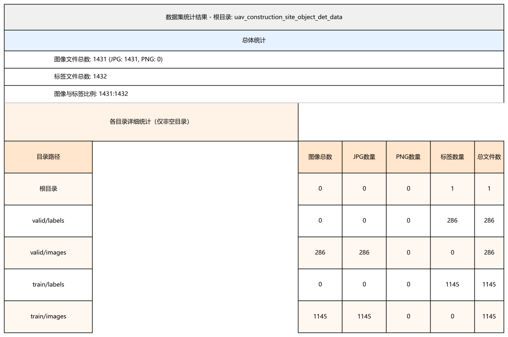
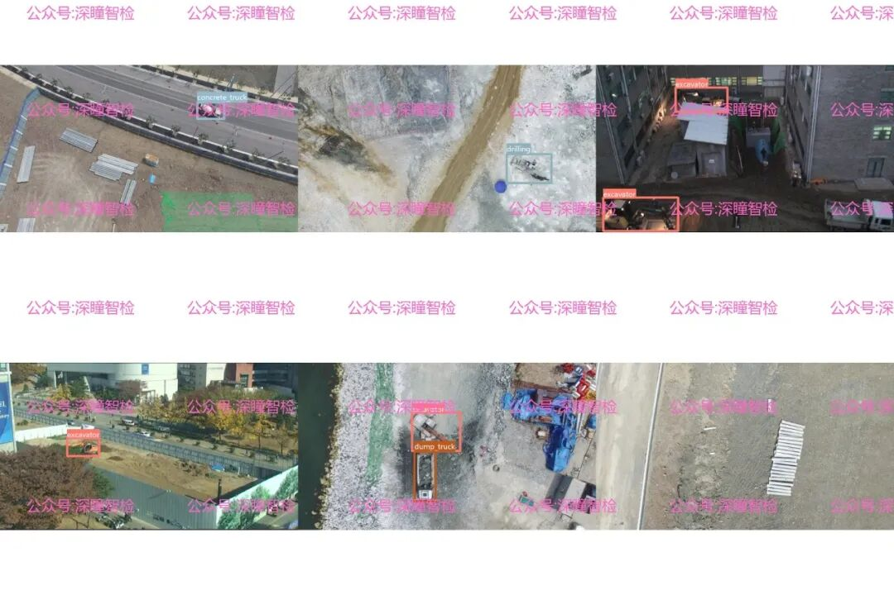
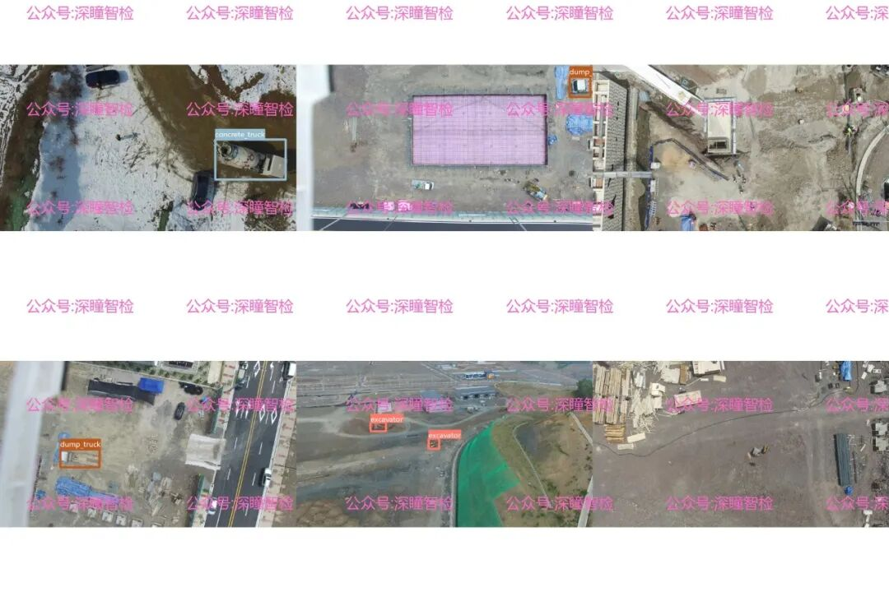

# Target Detection Dataset - Episode 090 - Drone Aerial Photo Construction Site Object Detection Dataset Based on the Yolo Annotation Format

#### 1. Background

In the wave of digital transformation in construction engineering, intelligent monitoring and management of construction sites have become one of the core directions for industry upgrading. The combination of drone aerial photography technology and computer vision is providing more efficient and comprehensive perception capabilities for construction site management. Today we are introducing the **Drone Aerial Photography Construction Site Object Detection Dataset**, which is a practical resource in this field.

With the increasing requirements of safety, efficiency and cost control in the construction industry, the concept of "smart construction site" is gradually moving from theory to practice: from equipment dispatching, personnel management to risk early warning, all need precise on-site data support.

Traditional on-site monitoring relies on manual inspection, which is not only time-consuming and laborious but also suffers from issues such as "incomplete coverage and delayed response." On the other hand, drone aerial photography, with its advantages of "wide view and strong flexibility," has become an ideal tool for collecting data on construction sites. However, to enable AI models to "understand" the equipment and vehicles in the construction site through images captured by drones, it is necessary to train AI models with high-quality target detection datasets —— this is the core background of the creation of this dataset.

Currently, there is a relative scarcity of public visual datasets for construction sites: on the one hand, the construction site environment is complex (with many types of equipment and frequent occlusion); on the other hand, the differences between different construction sites are significant, making the general dataset's adaptability insufficient. This dataset focuses on "construction site from the perspective of drone aerial photography," filling the data gap in this specific scene, providing basic support for AI applications in smart construction sites.

#### 2. Data details

This dataset is centered around the core scenario of "UAV aerial photography of construction sites," and it aligns with real-world monitoring needs in terms of data composition and annotation standards. The specific information is as follows:

###### (1) Data Scale and Division

The dataset consists of **1431 image files** (all in JPG format), accompanied by **1431 annotation files** (in YOLO format as TXT files). The whole dataset is divided into two parts: the training set and the validation set.

-

• **Training set**: contains 1145 images and corresponding 1145 annotation files, used for model training and learning;

-

• **Validation set**: Contains 286 images and corresponding 286 annotation files, used to verify the generalization ability of the model.

Such division ensures the availability of sufficient training data and effectively evaluates the model's performance in unseen construction site scenarios.

###### (2) Target Category and Scenario Coverage

The dataset targets common equipment and tools in construction sites, defining 6 core inspection objectives that cover key objects frequently encountered in the site.

-

• **Excavator**: The core equipment for earthwork operations in construction sites, with a high frequency of appearance in data sets.

-

• **Crane Truck**: Heavy-duty equipment responsible for lifting materials.

-

• **Concrete Truck**: A specialized vehicle for transporting concrete.

-

• **Self-Loading Truck (dump truck)**: A vehicle used for transporting waste, building materials.

-

• **Drilling Equipment (drilling)**: A specialized machinery for foundation operations and other scenarios.

-

• **Forklift**: A common equipment for short-distance material transfer within the construction site.

-

• Tower crane: The core lifting equipment for high-rise building construction.

From the perspective of the scene, the dataset covers different types of construction sites (such as earthwork operation areas and main building construction areas), including aerial images of different weather conditions and different time periods. At the same time, it also includes complex situations such as "equipment obstruction and dense distribution" that are commonly encountered in real construction sites, so that the trained model can better adapt to actual application scenarios.

###### (3) Annotation Standards and Quality

The annotation file is in YOLO format (each line corresponds to a target, including "class ID, target center x coordinate, target center y coordinate, target width, target height"). All annotations are based on the pixel coordinates of drone imagery, ensuring accurate target positioning.

At the same time, the dataset strictly follows the principle of "single target single annotation, bounding box fitting the contour of the target" in the annotation process, avoiding problems such as ambiguous annotation and repetitive annotation, which provides high-quality supervision information for model training.

#### 3. Application scenarios

The target detection model trained on this dataset can be widely applied in many core scenarios of intelligent construction sites, promoting the upgrading of construction site management to "automation and intelligence".

###### (1) Intelligent scheduling of construction site equipment

By using drone aerial photography and target detection models, real-time statistics on the quantity, location, and operational status of various equipment (such as excavators and dump trucks) within the construction site can be achieved. This aids management personnel in rationally allocating equipment resources to avoid situations where equipment is idle or there are insufficient equipment in the operation area, thereby enhancing construction efficiency.

###### (2) Automated early warning of safety risks

In the construction site, some equipment (such as tower cranes and jacks) may cause safety accidents due to illegal operation or improper arrangement. The model trained with this dataset can automatically identify risk scenarios such as "unsafe parking of equipment" and "high-risk operation areas with piled up equipment", and timely send warning information to management personnel to reduce safety hazards.

###### (3) Construction Progress Visualization Management

By integrating aerial imagery and target detection data from different time periods, it is possible to track the operational scope of equipment within the construction site and the frequency of material transportation. By comparing these data with construction plans, visual monitoring of construction progress can be achieved, assisting project managers in timely adjustments to construction schedules.

###### (4) Site Compliance Supervision

In some areas, there are specific regulations on the types of equipment and operating hours at construction sites. Through target detection models, it can automatically check whether the equipment in the construction site complies with the requirements, while also recording the operating time of the equipment, providing objective compliance data support for regulatory departments.

## Payment

Here is a pay link on Stripe ( https://buy.stripe.com/3cs8yP7sY87d0vu9AB ). Please contact me lonlonago@foxmail.com after funding $89, and I will send you a complete data files , thank you!

